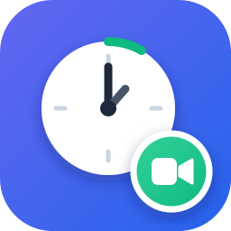

<div align="center">



# never-late

**Never be late for a meeting ever again.** ⏰

A tiny macOS background agent that opens your Zoom or Google Meet link about a minute before the meeting starts.

[](#-install)
[](never_late.swift)
[](LICENSE)
[](#-privacy)

</div>

---

## ✨ Features

- 🎯 **Joins on time, automatically.** Opens the meeting link about 1 minute before the start, so Zoom is already up when the clock hits the hour.
- 📅 **Works with every calendar.** Reads Calendar.app through EventKit: iCloud, Google, Exchange, and anything else Calendar.app syncs.
- 🔗 **Finds the link for you.** Looks in the event's URL field, then its location, then its notes. Understands `zoom.us/j/…`, `zoommtg://…` and `meet.google.com/xxx-xxxx-xxx`, including links hidden in HTML or Google redirects.
- 🧠 **Knows which meetings to skip.** Ignores all-day events, declined or tentative events, and events with no link. Unanswered invites and meetings you organize are kept.
- 🔁 **Never opens a meeting twice.** Remembers what it already opened, even across overlapping runs.
- 🪶 **Featherweight.** One Swift file, no dependencies, no menu bar icon, no Dock icon. launchd wakes it once a minute.
- 🔒 **Private by design.** Everything stays on your Mac. No accounts, no network calls, no telemetry.
- 🧪 **Tested.** `./test.sh` checks link extraction against fixtures without touching your calendar.

## 💡 Why this exists

Joining a meeting on time should be the most automatic thing in the world. It looks like an obvious feature for Zoom to have, but it doesn't. I was tired of being five minutes late to meetings. It isn't professional, and the cause was never bad intent, just "one more thing" and a calendar notification I swiped away. So I built the feature myself. Hopefully it helps you too.

## 🚀 Install

Requires macOS 14 or later and the Xcode Command Line Tools (`xcode-select --install`).

```bash
git clone https://github.com/RuneStone0/never-late.git
cd never-late
./install.sh
```

This compiles the binary into `bin/NeverLate.app`, signs it ad hoc, generates the launchd plist for your paths and loads it. Calendar access belongs to that app bundle, not to your terminal. If macOS asks, choose **Allow Full Access**. Rebuilding changes the signature, so you may be asked again.

To remove it again: `./uninstall.sh`.

## 🛡️ Pro tip

In Zoom, turn on **Settings → Video → Turn off my video when joining a meeting**, and mute your microphone on join too. This tool joins for you, so if you aren't at your desk it should not stream your living room to your colleagues.

## 🔍 How it works

launchd runs the agent every 60 seconds, and each run:

1. **Reads** events starting in the next ~5–70 seconds from all calendars. The window is wider than 60 seconds so consecutive runs overlap and a late launchd tick can't skip a meeting.
2. **Filters** out all-day events and events you declined or marked tentative.
3. **Finds a link** in the event's URL field, then its location, then its notes. Events without a link are ignored.
4. **Opens it** with `open <link>`, once per meeting. Which meetings were already opened is remembered in `~/Library/Application Support/never-late/state.json` (entries are pruned after 24 hours).

A failure on one event is logged and doesn't affect the others. The log is `~/Library/Logs/never-late.log`; it only gets a line when something starts soon or goes wrong.

## 🧰 Options

To see what the agent sees (this must go through the app bundle so it uses the bundle's Calendar permission):

```bash
open -W -n --stdout /dev/stdout bin/NeverLate.app --args --debug --window -3600 3600
```

| Option | What it does |
| --- | --- |
| `--debug` | Like `--dry-run`, and logs every event in the window with why it was kept or skipped |
| `--dry-run` | Logs what would be opened without opening anything or writing state |
| `--window MIN MAX` | Looks at events starting MIN..MAX seconds from now (default `5 70`, may be negative) |
| `--calendars "Work,Home"` | Only reads these calendars (default: all) |

## 🧪 Tests

```bash
./test.sh
```

Compiles the program and checks link extraction against `fixtures/events.json`. It doesn't touch your calendar.

## 🔐 Privacy

never-late runs entirely on your Mac. It reads your calendar locally, opens a link with the system `open` command, and writes a small state file and a log in your Library folder. Nothing is sent anywhere. The log can contain meeting titles, so keep that in mind if you share it.

## ⚠️ Limitations

- Only events that Calendar.app has synced are seen. A meeting created in the web UI moments before it starts may not have arrived yet.
- If the Mac is asleep at the trigger time, that meeting isn't opened afterwards.
- Zoom `https` links open in your default browser first, which then hands off to the Zoom app.
- Zoom and Google Meet only. Teams, Webex and others are not matched.

## 📄 License

[MIT](LICENSE) © Rune Kristensen
